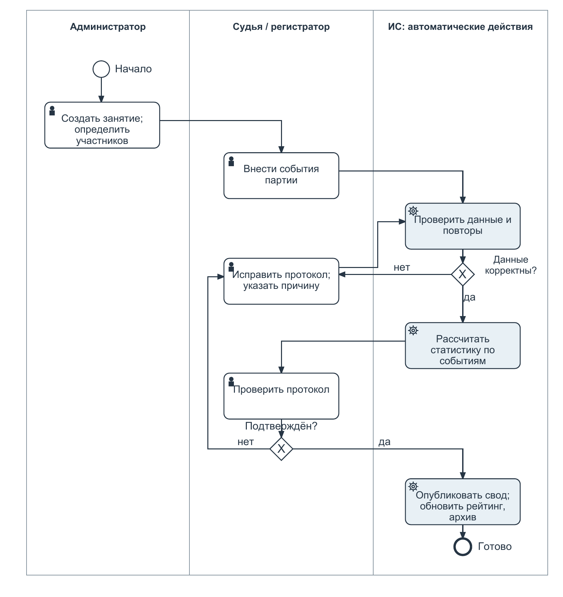

# Концепция информационной системы

## Лабораторная работа № 2

Дисциплина: «Проектирование информационных систем».

**Организация тренировок и учёт результатов любительского бильярдного клуба.**

Университет ИТМО. Санкт-Петербург, 2026.

Тема согласована с преподавателем. Дополнительные ограничения преподавателем не установлены.

| Участник команды | Роль в работе | Разделы отчёта |
|---|---|---|
| Борисюк Е. Г., К3340 | Бизнес-аналитик | 1: объект, AS-IS, проблемы, требования |
| Езиева Милана | Аналитик решений, архитектор | 2–3: обзор, альтернативы, ресурсы |
| Федорова Мария | Системный аналитик | 4–5: выбор концепции, модель TO-BE |
| Петрова Мария | Экономист проекта | 6: эффекты и экономическое обоснование |
| Муравьев Матвей | Руководитель проекта, качество и ИБ | 7–9: риски, приёмка, план, выводы |

**Цель работы:** разработать альтернативные концепции информационной системы, сопоставить их с требованиями, ресурсами и рисками и обосновать выбор.

**Основание:** методические указания к работе «Разработка концепции информационной системы» [1] и согласованная тема из дополнительного перечня [2]. Работа соответствует стадии «Разработка концепции АС» по ГОСТ Р 59793-2021. Аналитический обзор заменяет учебные НИР, как предусмотрено методическими указаниями.

Отдельный отчёт предыдущей стадии не задан. Для выполнения работы сформирована учебная модель объекта и требований. Величины нагрузки, времени и стоимости труда ниже являются исходными допущениями расчётов, а не результатами фактического обследования. Они одинаковы для всех альтернатив.

Результат — концепция ИС: объект и требования; обзор аналогов; три варианта с ресурсами; матрица соответствия и многокритериальный выбор; BPMN TO-BE; эффекты и бизнес-кейс; риски; порядок приёмки; дорожная карта. Основной формат — Markdown с таблицами и рисунком в ветви lab02-concept; PDF представляет тот же отчёт.

<!-- pagebreak -->

# 1. Характеристика объекта и требования пользователя

**Работа:** лабораторная № 2 «Разработка концепции информационной системы». **Тема:** организация тренировок и учёт результатов любительского бильярдного клуба. **Автор раздела:** Борисюк Е. Г., К3340.

## 1.1. Основание и статус данных

Рассматривается учебный кейс клуба по пулу-8. Отдельный отчёт обследования не задан. Ниже используется учебная модель AS-IS; показатели нагрузки и времени являются расчётными допущениями.

Заказчик — руководитель клуба. Цель — получать достоверные результаты тренировок и видеть прогресс, сократив повторный ввод и ручные пересчёты. Объект автоматизации — организация тренировочного занятия, регистрация событий партии, подтверждение результатов и подготовка статистики.

Рабочий масштаб: 5–10 игроков на занятии, 30 зарегистрированных игроков, 3 организатора, 2 стола, 60 занятий в год и 20 одновременных пользователей. Эти величины являются допущениями, а не статистикой посещаемости. Под тренировкой понимается одно занятие клуба, а не один подход или партия.

## 1.2. Участники и границы

| Участник | Действия и интерес |
|---|---|
| Игрок | Записывается, играет, проверяет свой результат и динамику |
| Тренер | Назначает упражнения, определяет оценку качества отыгрыша, анализирует прогресс |
| Судья / назначенный регистратор | Записывает события, разбирает замечания, подтверждает протокол |
| Администратор клуба | Ведёт расписание, участников, доступ и архив; отвечает за копии |
| Руководитель клуба | Утверждает правила, приоритеты, бюджет и решение о запуске |

Один человек может совмещать тренера и судью. Право изменять спорный протокол принадлежит назначенному ответственному; игрок не должен самостоятельно утверждать исправление своей партии.

В границах: расписание, запись, события партий, показатели тренировки, подтверждение, рейтинг и личная динамика, выгрузка и архив. За границами: касса, платежи, бухгалтерия, контроль доступа в помещение, автоматическое распознавание ударов по видео, официальные спортивные разряды, бронирование столов внешними посетителями. ИС не определяет успешность отыгрыша: решение принимает тренер/судья.

## 1.3. AS-IS: как организована работа сейчас

В учебной исходной модели администратор объявляет тренировку в чате и вручную собирает ответы. На занятии тренер назначает пары. Назначенный регистратор отмечает шары, фолы и успешные отыгрыши на бумаге. После занятия переносит записи в таблицу, рассчитывает показатели и пересылает итог в чат. Игрок сообщает о неточности; судья проверяет записи, исправляет таблицу и повторно публикует результат. Для оценки прогресса тренер собирает несколько файлов.

Чат используется для общения, бумага — для первичной записи, таблица — для свода. Базовые показатели для расчётов: 90 минут административной работы на занятие, из них 30 минут организация и 60 минут перенос/пересчёт/подготовка свода; 10% протоколов требуют исправления; публикация занимает до суток. Все три значения — гипотезы для последующего замера.

<!-- pagebreak -->

# 1. Характеристика объекта и требования (продолжение)

## 1.4. Проблемы AS-IS

| ID | Проблема | Последствие | Требования |
|---|---|---|---|
| P1 | Заявки в чате не образуют единого списка | Пропуски участников и ручная сверка | F1 |
| P2 | События с бумаги переносят повторно | Опечатки и лишнее время | F2, N1 |
| P3 | Результаты и статистику рассчитывают вручную | Ошибки свода | F3, F4 |
| P4 | Не фиксируются причины и авторы правок | Споры о достоверности | F5, N3 |
| P5 | История разнесена по отдельным файлам | Сложно оценить прогресс | F6, F7 |
| P6 | Свод публикуется с задержкой | Игрок не получает своевременную обратную связь | F6, N2 |
| P7 | Не проверяется восстановление архива | Потеря результатов и лишний доступ | F8, N3, N4 |

## 1.5. Функциональные требования

Must — обязательное требование: несоответствующий вариант исключается до балльной оценки. Should — желательное улучшение, учитываемое при сравнении. Требование определяет результат; допустимость организационного способа его выполнения указывается отдельно.

| ID | Требование | Приоритет | Признак выполнения |
|---|---|---|---|
| F1 | Вести расписание и единый список участников занятия | Must | Одно занятие имеет один актуальный состав |
| F2 | Учитывать партии, игроков и события: шары, фолы, отыгрыши | Must | По протоколу восстанавливается ход партии |
| F3 | Рассчитывать число партий, побед и зарегистрированных событий | Must | Итоги совпадают с контрольным протоколом |
| F4 | Сохранять состав и показатели подтверждённого протокола | Must | Правка не подменяет исходный подтверждённый результат |
| F5 | Подтверждать результаты и сохранять автора/причину изменения | Must | Есть исходная и новая ревизии с ответственным |
| F6 | Показывать историю и динамику результатов игрока | Should | Доступна история по периоду |
| F7 | Автоматически формировать сводный рейтинг по результатам партий | Should | Рейтинг строится из подтверждённого архива |
| F8 | Выгружать протоколы и восстанавливать архив из копии | Must | Выгрузка читается, копия восстанавливается |

<!-- pagebreak -->

# 1. Характеристика объекта и требования (окончание)

Победитель партии определяется правилами выбранной игры, а статистика описывает зарегистрированные результаты. Для сопоставимости в своде указывается число сыгранных партий. Подтверждение достоверности событий остаётся за судьёй или назначенным регистратором.

## 1.6. Нефункциональные требования

| ID | Требование | Приоритет | Обоснование |
|---|---|---|---|
| N1 | Ввод типового события за ≤10 с после обучения | Should | Регистрация не должна отвлекать от игры |
| N2 | Подтверждённый итог доступен в течение 5 мин | Should | Оперативная обратная связь игрокам |
| N3 | Редактируют только назначенные ответственные; игрокам доступны разрешённые своды | Must | Защита от произвольных исправлений |
| N4 | RPO ≤24 ч, RTO ≤4 ч | Must | Допустимая потеря данных и время восстановления |

RPO — допустимый интервал потери данных между последней восстановимой копией и аварией; RTO — допустимая продолжительность восстановления. Эти показатели предложены для учебной модели небольшого клуба и подлежат проверке при приёмке.

## 1.7. Ограничения и исходные условия

| ID | Условие | Применение при сравнении |
|---|---|---|
| C1 | Один небольшой клуб: 30 зарегистрированных игроков, 5–10 на занятии, 2 стола | Одинаковый масштаб для всех концепций |
| C2 | У клуба уже есть ПК с лицензированным табличным редактором и телефоны участников | Покупка этих устройств не входит в создание ИС |
| C3 | Обрабатываются только сведения, необходимые для организации и результатов занятий | Персональные сведения доступны ответственным, публичный свод обезличен |

C1–C2 — расчётные допущения, C3 — ограничение состава обрабатываемой информации. Дополнительные лимиты бюджета, срока или обязательного размещения в РФ преподаватель не задавал; такие лимиты не используются для исключения альтернатив. Затраты и сроки оцениваются как характеристики вариантов.

Объём для бизнес-кейса: 60 занятий в год, 20 одновременных пользователей, горизонт владения 3 года. В расчёт входят организация занятия, регистрация/перенос событий, проверка и свод. Длительность самой игры не считается административными затратами.

За границами автоматизации остаются платежи и бухгалтерия, видеораспознавание ударов, управление спортивными разрядами. Успешность отыгрыша определяет человек. Эти границы исключают расширение концепции за пределы выбранной темы.

<!-- pagebreak -->

# 2. Аналитический обзор

Сравниваются четыре действующих решения по одинаковым признакам. Функции в таблице подтверждены официальными страницами [3–8]; пригодность для наших требований — аналитическая оценка команды. Отсутствие функции на странице означает «не подтверждено», а не «точно отсутствует».

| Решение | Функции и применимость | Лицензирование / цена |
|---|---|---|
| Р7, редактор таблиц | Табличный учёт и своды; онлайн-версия поддерживает совместное редактирование. Учёт тренировок требует настройки шаблона | Коммерческая лицензия. Десктопная бизнес-версия от 6 000 руб./год; это не цена серверного совместного доступа [3,4] |
| CueScore | Бильярдные турниры, лиги, рейтинги, цифровое табло; учёт наших типов событий и штрафов не подтверждён | SaaS, платный Pro; окончательная цена уточняется для региона/периода подписки [5] |
| Challonge | Турнирные сетки и учёт результатов; подробная статистика событий тренировки требует отдельной проверки | SaaS, есть стандартный план; Premier 6,99 долл./месяц при годовой оплате [6] |
| Baserow | Конструктор таблиц/форм, импорт/экспорт; пригоден как основа учёта, но доменные правила нужно настроить | Есть Free и платные планы. RBAC и audit logs не включаем в бесплатный вариант: они перечислены в Advanced [8] |

| Решение | Интеграция | Размещение и ограничение |
|---|---|---|
| Р7 | Обмен файлами; совместная работа через соответствующее серверное/облачное окружение | В A используется локальный файл на ПК клуба |
| CueScore | Официальный beta API: JSON турниров, матчей и результатов; стабильность схемы не гарантируется [5] | Российское размещение основного архива в просмотренных материалах не подтверждено |
| Challonge | Официальный API; его платные планы учитываются отдельно [7] | Контроль размещения в РФ не подтверждён |
| Baserow | API, импорт и экспорт, варианты Cloud и Self-host [8] | В B рассматривается самостоятельное размещение на сервере клуба |

**Вывод обзора.** CueScore ближе к бильярдным соревнованиям, Challonge — к турнирным сеткам, Р7 — к простому табличному учёту, Baserow — к построению связанных регистров. Наличие турнирной сетки не доказывает поддержку событий тренировки и процедур исправления протоколов. Для этой задачи сравниваются организационный вариант, настраиваемая low-code платформа и собственное приложение. Готовые турнирные сервисы рассмотрены в обзоре; сравниваемые концепции различаются способом автоматизации и объёмом необходимых доработок.

Публичные тарифы зарубежных сервисов приведены в исходной валюте для обзора. В сметах A/B/C их подписки не используются. Часы настройки, поддержки и инфраструктурные лимиты — учебные оценки, явно указанные в разделе 3.

<!-- pagebreak -->

# 3. Альтернативные концепции

## 3.1. Варианты A и B

**A — организационное решение и локальные таблицы.** Администратор ведёт один защищённый мастер-файл, регистратор использует типовой бумажный протокол, после занятия вводит итоговые события; формулы рассчитывают статистику. Подписанный протокол и его исходная версия сохраняются вместе. Исправления — через новый лист/версию с причиной. Игроки получают отдельную выгрузку с псевдонимами. Автоматического личного кабинета и единого интерфейса регистрации нет.

Архитектура: ПК клуба → локальный мастер-файл → разрешённые своды; отдельная ежедневная копия на подконтрольном носителе в РФ. Используется уже имеющаяся лицензия редактора; при её отсутствии к ежегодной смете добавляется минимум 6 тыс. руб. за одну десктопную лицензию Р7. Совместный сервер Р7 не приобретается. Доступ защищается учётной записью ПК, редактирование только у назначенного администратора.

Ресурсы: аналитик 8 ч, настройщик таблиц 8 ч, тренер/обучение 4 ч. Всего 20 ч = 0,125 чел.-месяца по 160 ч. Срок 1 неделя при частичной занятости. Ставка 700 руб./ч, труд 14 тыс., резерв 15% — 2,1 тыс.; создание 16,1 тыс. руб.

Плюсы: быстрый запуск, минимальные затраты, понятный экспорт. Минусы: бумага и повторный ввод остаются, защита и история зависят от дисциплины, удобство низкое. Must исполняются формулами, архивом версий и регламентом; это не автоматический неизменяемый журнал.

**B — self-hosted low-code.** Baserow Free на подконтрольном сервере, связанные регистры занятий/событий, формы ввода, настроенные расчёты и небольшой модуль фиксации подтверждённого снимка протокола. Игрокам выдаются отдельные разрешённые выгрузки, доступ к внутренней базе закрыт. Не предполагается наличие бесплатных штатных RBAC или audit logs. Дополнительный модуль и регламент компенсируют этот разрыв; их работоспособность надо подтвердить пилотом.

Архитектура: браузер регистратора → локальный/российский сервер платформы → база → модуль снимков и резервная копия. Прямого доступа игроков к сырой базе нет. Платные расширенные права не заложены, публичные персональные страницы не создаются.

Ресурсы: аналитик 16 ч, настройщик/разработчик 60 ч, тестировщик 16 ч, администратор/обучение 8 ч. 100 ч = 0,625 чел.-месяца. Срок 4 недели; 70 тыс. труда + 10,5 тыс. резерва = 80,5 тыс. руб.

Плюсы: единая база, быстрый ввод, меньше ручного свода, контролируемое размещение. Минусы: ограничения конструктора, дополнительные снимки и регламент, сопровождение обновлений платформы и модуля, нет полностью специализированного интерфейса.

<!-- pagebreak -->

# 3. Альтернативные концепции (продолжение)

## 3.2. Вариант C и свод ресурсов

**C — собственное веб-приложение.** Единый интерфейс расписания, ввода событий и подтверждения протокола. Расчёт основан на зарегистрированных событиях и подтверждённых партиях. Исправление создаёт новую ревизию с причиной, подтверждённая старая версия сохраняется; публикация и рейтинг строятся только по подтверждённым данным. Игрокам доступны личная история и разрешённый свод. Правила доступа задаются по ролям.

Укрупнённая архитектура: мобильный браузер → единое веб-приложение → реляционная БД → резервная копия в РФ. Достаточно монолитного приложения, например Python/FastAPI и PostgreSQL; это возможный стек, окончательный выбор делается в ТЗ. Интеграции с платежами и видео отсутствуют. Сбой связи обрабатывается временным бумажным протоколом с последующим контролируемым переносом, полноценный офлайн-режим не обещается.

| Работа C | Часы | Содержание |
|---|---|---|
| Анализ | 32 | Уточнение сценариев, правил и приёмки |
| Разработка | 168 | Учёт, права, события, версии и статистика |
| Тестирование | 48 | Расчёт статистики, доступ, резервирование |
| Развёртывание и документация | 16 | Сервер, инструкции и восстановление |
| Обучение и пилотная поддержка | 16 | Работа с регистратором и разбор замечаний |
| Всего | 280 | 1,75 чел.-месяца |

Ставка C — 800 руб./ч: более высокая доля программирования и проверки доступа. 224 тыс. руб. труда + резерв 33,6 тыс. (15%) = 257,6 тыс. руб. Два разработчика могут совмещать другие роли; календарный срок 10 недель при частичной занятости. Это оценка MVP, а не предложение промышленного подрядчика.

| Параметр | A | B | C |
|---|---|---|---|
| Создание, тыс. руб. с резервом | 16,1 | 80,5 | 257,6 |
| Человеко-часы | 20 | 100 | 280 |
| Чел.-месяцы по 160 ч | 0,125 | 0,625 | 1,75 |
| Срок до пилота | 1 нед. | 4 нед. | 10 нед. |
| Эксплуатация в год, тыс. руб. | 15,4 | 41,4 | 49,4 |
| Сильная сторона | Цена и срок | Быстрая автоматизация | Удобство и проверяемость |
| Главный недостаток | Регламент и повторный ввод | Ограничения платформы | Затраты и зависимость от команды |

Ежегодная эксплуатация: A — копии/носитель 3,4 тыс. и 20 ч поддержки ×600 = 12 тыс.; B — сервер/копии 12 тыс. и 42 ч ×700 = 29,4 тыс.; C — сервер/копии 15,8 тыс. и 48 ч ×700 = 33,6 тыс. Ставки и инфраструктурные лимиты — внутренние учебные оценки. Отдельный сервер под A не покупается. Резерв расходуется только по решению заказчика; в TCO он консервативно включён полностью.

<!-- pagebreak -->

# 4. Сравнение и обоснование выбора

## 4.1. Матрица соответствия требованиям

«Регл.» означает выполнение обязательного требования организационной мерой, «част.» — ограниченное выполнение желательного требования. Это проектная оценка возможности реализации; итоговая приёмка проверяет фактический результат.

| Требование | A: регламент/таблицы | B: low-code | C: своё приложение |
|---|---|---|---|
| F1 Must: занятия и участники | Да, мастер-файл | Да, регистры | Да |
| F2 Must: партии и события | Регл., бумага → файл | Да, формы | Да |
| F3 Must: расчёт статистики | Да, формулы | Да, настройка | Да |
| F4 Must: сохранность подтверждённой версии | Регл., архивный снимок | Модуль снимков | Да, ревизии |
| F5 Must: подтверждение и причины правок | Регл., подписанные версии | Модуль и регламент | Да, ревизии |
| F6 Should: история и динамика | Част., ручной свод | Да, представления | Да |
| F7 Should: автоматический рейтинг | Част., ручной запуск свода | Част., настройка | Да |
| F8 Must: экспорт/восстановление | Регл., копии | Да + копии | Да + копии |
| N1 Should: ввод ≤10 с | Не гарантирован | Проверяется пилотом | Проверяется пилотом |
| N2 Should: публикация ≤5 мин | Ручная выгрузка | Част., выгрузка | Автоматическая |
| N3 Must: назначенные редакторы | Один редактор, отдельные своды | Закрытая база, выгрузки | Роли и разрешённые своды |
| N4 Must: RPO/RTO | Копии и инструкция | Копии и инструкция | Копии и инструкция |
| C1: масштаб клуба | Достаточен | Достаточен | Достаточен |
| C2: имеющееся оборудование | Используется | Используется | Используется |
| C3: ограничение состава данных | Минимальный реестр | Минимальный реестр | Минимальный реестр |

Все три варианта допускаются к сравнению, поскольку предусматривают выполнение Must. У A и B часть требований выполняется регламентом и дополнительными механизмами; это снижает оценки удобства и проверяемости. Нельзя компенсировать установленное невыполнение Must низкой стоимостью: такой вариант подлежит исключению, а не снижению общей оценки.

Матрица отделяет принципиальную реализуемость от степени автоматизации. Если регламент архивирования или ограничения редактирования не соблюдается, A не выполняет F4/F5/N3; если модуль снимков B не сохраняет исходную версию, B не выполняет F4. Эти условия проверяются при приёмке.

<!-- pagebreak -->

# 4. Сравнение и обоснование выбора (окончание)

## 4.2. Принцип выбора критериев

Приняты следующие проектные приоритеты: основной интерес — покрыть предметные требования, затем учесть стоимость, срок, удобство, контроль, независимость и развитие. Критерии и веса согласованы 26.10.2026 с Борисюком Е. Г., выступающим учебным представителем заказчика. Цена и TCO объединены в один критерий, чтобы не учитывать затраты дважды. Все баллы направлены одинаково: 5 лучше 1.

| Критерий | Вес | A | B | C |
|---|---|---|---|---|
| Полнота и степень автоматизации требований | 0,30 | 3 | 4 | 5 |
| TCO за 3 года | 0,20 | 5 | 3 | 2 |
| Срок подготовки к пилоту | 0,15 | 5 | 4 | 2 |
| Удобство ввода и получения истории | 0,15 | 2 | 3 | 5 |
| Проверяемость изменений и контроль доступа | 0,10 | 2 | 3 | 5 |
| Независимость от внешнего поставщика | 0,05 | 4 | 3 | 5 |
| Возможность развития | 0,05 | 2 | 4 | 4 |
| Итог S | 1,00 | 3,45 | 3,50 | 3,90 |

Оценка покрытия: 3 — базовые Must в основном регламентом, 4 — единый учёт с частичной доработкой, 5 — целостная доменная автоматизация. TCO: 5 при ≤75 тыс., 4 при >75–150, 3 при >150–250, 2 при >250–450, 1 выше 450 тыс. Срок: 5 при ≤1 нед., 4 при >1–4, 3 при >4–8, 2 при >8–12, 1 выше 12 недель.

Для остальных критериев 1 означает существенные ручные обходы/закрытость, 3 — настраиваемое типовое решение с ограничениями, 5 — встроенное выполнение без внешней продуктовой зависимости; промежуточные 2/4 отражают частичное соответствие. A получает 2 за удобство из-за повторного ввода, B — 3 из-за общих форм, C — 5 за специализированные действия (гипотеза для проверки). Контроль A=2 из-за ручных версий, B=3 из-за дополнительного снимка, C=5 из-за предусмотренных ролей и ревизий. Независимость C=5 означает владение кодом и экспортом, а не отсутствие зависимости от сопровождающих людей. Масштабируемость C=4: единое приложение пригодно к развитию, но нагрузочные испытания ещё не проводились.

Формула: S_i = сумма(w_j × s_ij). Для C: 0,30×5 + 0,20×2 + 0,15×2 + 0,15×5 + 0,10×5 + 0,05×5 + 0,05×4 = **3,90**. Баллы экспертные, не результаты замера интерфейсов.

## 4.3. Устойчивость

Меняем вес покрытия на ±0,05. Другие веса умножаем на (1−новый вес)/(1−0,30), чтобы сумма оставалась 1. Это проверка чувствительности одного критерия, а не доказательство устойчивости ко всем предпочтениям.

| Вес покрытия | A | B | C | Лидер |
|---|---|---|---|---|
| 0,25 | 3,482 | 3,464 | 3,821 | C |
| 0,30 | 3,450 | 3,500 | 3,900 | C |
| 0,35 | 3,418 | 3,536 | 3,979 | C |

C сохраняет лидерство. Но при снижении оценки его удобства с 5 до 2 итог C становится 3,45, и лидирует B с 3,50. Поэтому утверждение удобства — отдельный риск выбора. Для моделирования TO-BE принимается C как функционально предпочтительная концепция. Инвестиционный запуск оценивается отдельно в разделе 6: высокий балл не доказывает окупаемость.

<!-- pagebreak -->

# 5. Выбранная концепция и модель TO-BE

Для целевой модели принята концепция C — единое веб-приложение для организации тренировок и учёта результатов. Она получила наибольшую многокритериальную оценку. Решение об инвестиционном запуске принимается с учётом экономического результата раздела 6.

Администратор создаёт занятие и список участников. Во время партии судья или назначенный регистратор вносит результат и события. Система проверяет состав данных и повторные записи, рассчитывает статистику. Судья сверяет протокол с ходом партии. При замечаниях он исправляет запись и указывает причину; система формирует новую ревизию и пересчитывает показатели. После подтверждения публикуется разрешённый свод, обновляется рейтинг и архивируется протокол.

## 5.1. Границы и ответственность

Автоматизируются хранение списка, регистрация и проверка данных, расчёт статистики, история ревизий, свод и публикация. Люди выбирают участников, играют, определяют успешность отыгрыша и достоверность результата, разрешают спор и подтверждают протокол. ИС не принимает судейские решения.

Резервирование выполняется по регламенту эксплуатации. Архивирование одного подтверждённого протокола в модели процесса не заменяет резервное копирование всей базы.

## 5.2. Обозначения BPMN 2.0

Один пул «Тренировка клуба» содержит три дорожки: администратор, судья/регистратор и ИС. User Task — действие человека с системой; Service Task — автоматическая операция. Стартовое и конечное события показывают границы процесса. Исключающие шлюзы XOR выбирают один исход: корректность данных и подтверждение протокола. Ветки «нет» возвращают на исправление, ветки «да» ведут к расчёту и публикации.

Между дорожками одного пула используются потоки последовательности. Неподтверждённые и промежуточные результаты не публикуются. Единица прохода основного цикла — протокол партии, связанный с занятием; для следующих партий регистрация и подтверждение повторяются.

<!-- pagebreak -->

# 5. BPMN 2.0: целевой процесс

Белые задачи — действия человека; голубые — автоматические задачи ИС. Ромбы X — выбор одного пути. Основной процесс идёт сверху вниз; ветки «нет» возвращают протокол на исправление.

<!-- pagebreak -->

# 5. Связь TO-BE с проблемами AS-IS

| Проблема | Изменение в целевом процессе | Ожидаемый результат |
|---|---|---|
| P1: заявки разнесены по чату | Единое занятие и состав участников | Не требуется собирать несколько списков |
| P2: повторный перенос | Прямой ввод событий | Перенос с бумаги остаётся аварийным способом |
| P3: ручной расчёт | Автоматический свод из событий и результатов | Снижение арифметических ошибок |
| P4: непрозрачные изменения | Автор, причина, исходная и новая ревизии | Проверяемая история и повторное подтверждение |
| P5: разрозненная история | Единый архив и статистика по периоду | Видна динамика игрока |
| P6: поздняя публикация | Публикация после подтверждения | Нет ожидания ручной подготовки свода |
| P7: риск утраты и лишнего доступа | Права, копии и проверка восстановления | Контролируемый доступ и восстановимость |

Изменения не сводятся к переносу старой таблицы в браузер: устраняются повторный ввод и ручной пересчёт, вводится обязательный переход через подтверждение, а корректировки сохраняют происхождение результата.

## 5.3. Принцип обработки исправлений

До подтверждения протокол находится в рабочем состоянии. После подтверждения исходная версия сохраняется. Любая корректировка создаёт новую ревизию с автором, временем и причиной; обновлённые показатели публикуются после повторного подтверждения. Поэтому игрок может понять, почему изменился его результат, а судья — восстановить исходные сведения.

При недоступности сервера применяется бумажный протокол. После восстановления ответственный переносит записи и сверяет их с уже сохранёнными событиями. Полноценная офлайн-синхронизация не включена в концепцию: для масштаба кейса достаточно организационного аварийного порядка.

## 5.4. Передача в ТЗ

В следующую стадию передаются выбранная концепция, роли и границы, требования F1–F8/N1–N4, модель BPMN, правила подтверждения и изменения протоколов, показатели приёмки и ресурсная оценка. Подробные экранные формы, схема БД и программные интерфейсы в концепции не проектируются.

<!-- pagebreak -->

# 6. Эффекты и технико-экономическое обоснование

Горизонт — три полных года эксплуатации после создания. Инфляция, дисконтирование, налоги и остаточная стоимость не учитываются: расчёт учебный и сравнительный. Денежная единица таблиц — тыс. руб. Все трудозатраты и лимиты инфраструктуры приведены в разделе 3. Эксплуатация включает поддержку; административная работа по занятиям считается отдельно.

## 6.1. Источник ожидаемого эффекта

База: 60 занятий/год ×90 минут административного труда. Оценка после внедрения: A — 55 мин, B — 40 мин, C — 25 мин на занятие. Уменьшение касается организации, переноса и свода, а не времени игры. Ввод новых событий уже включён в эти оценки. Это гипотезы, подлежащие пилотному замеру; не измеренные результаты.

Расчётная ценность высвобождённого часа — 600 руб. Ставка задана как внутренняя оценка стоимости административного труда, а не взята из прайс-листа. Объём исправлений входит в 90 минут и повторно не монетизируется. Доход от новых игроков, рост выручки столов и предотвращённая утечка данных в денежный эффект не включены.

Формулы: E = N × (t_AS-IS − t_TO-BE) / 60 × r. TCO = C_созд + 3 × C_экспл. T_ок = C_созд / (E − C_экспл), если E > C_экспл. ROI_3 = (3E − TCO) / TCO ×100%.

| Показатель | A | B | C |
|---|---|---|---|
| Создание с резервом | 16,1 | 80,5 | 257,6 |
| Эксплуатация в год | 15,4 | 41,4 | 49,4 |
| Высвобождено часов в год | 35 | 50 | 65 |
| Расчётный эффект E в год | 21,0 | 30,0 | 39,0 |
| Чистый годовой эффект | 5,6 | −11,4 | −10,4 |
| TCO за 3 года | 62,3 | 204,7 | 405,8 |
| Эффект за 3 года | 63,0 | 90,0 | 117,0 |
| ROI за 3 года | 1,12% | −56,03% | −71,17% |
| Простая окупаемость | 2,88 года | не достигается | не достигается |

Для C: E = 60×(90−25)/60×600 = 39 000 руб./год. TCO = 257 600 + 3×49 400 = 405 800 руб. ROI = (117 000−405 800)/405 800×100% = −71,17%. E < C_экспл, поэтому отрицательное число вместо срока окупаемости не выводится.

Это экономическая оценка мощности, а не обещание денежной экономии. Чтобы эффект стал денежным, заказчик должен подтвердить уменьшение оплачиваемых часов либо документируемое полезное использование освобождённого времени. Если зарплата фиксирована, расходы сами по себе не уменьшаются.

<!-- pagebreak -->

# 6. Неденежные эффекты и вывод бизнес-кейса

## 6.2. Измеримые неденежные эффекты

| KPI | Исходная оценка → целевое значение C | Способ измерения |
|---|---|---|
| Административное время на занятие | 90 → ≤25 мин | Одинаковый хронометраж 10 исходных и 10 пилотных занятий |
| Доля протоколов с ошибкой при сверке | 10% → ≤3% | Сверка не менее 100 протоколов, одинаковая классификация ошибок |
| Правки с автором и причиной | Учёт не ведётся →100% | Проверка всех корректировок пилотного периода |
| Срок публикации после подтверждения | До суток →≤5 мин | Сопоставление времён подтверждения и публикации по 30 протоколам |
| Удовлетворённость регистраторов | База не измерена →≥4 из 5 | Одинаковая анкета до/после, не менее 5 пользователей |

Исходные значения времени и ошибок — гипотезы учебной модели, целевые — условия оценки эффекта. Ожидаемые значения не выдаются за фактически достигнутые. Высвобождение времени уже учтено в денежном бизнес-кейсе и повторно не прибавляется как отдельная экономия на исправлениях.

## 6.3. Экономическая целесообразность

A имеет условно положительный трёхлетний ROI 1,12% при имеющемся редакторе и принятой стоимостной оценке высвобождённого времени. Его простая окупаемость —2,88 года. B и C при принятой нагрузке не окупаются: годовой эффект меньше эксплуатационных затрат.

C выбран как функционально предпочтительная концепция: он лучше обеспечивает удобство и контролируемость истории. Однако многокритериальная оценка не является доказательством возврата инвестиций. По текущим исходным данным коммерческий запуск C за счёт одной только экономии административного труда не обоснован.

Практическое решение для данного масштаба —использовать A как организационный этап; C может развиваться как учебный проект с отдельным финансированием после подтверждения потребности. Необходимость такого финансирования следует из расчёта. Вложения не объявляются оправданными только потому, что система получила высокий балл.

Срок окупаемости B/C не записывается отрицательным числом: при E ≤ C_экспл возврат первоначальных затрат в принятой модели отсутствует. Экономическая ценность освобождённых часов станет фактической денежной экономией только при уменьшении оплачиваемых часов либо подтверждённом полезном использовании мощности.

<!-- pagebreak -->

# 7. Реестр рисков

Вероятность P: 1 — исключительный случай, 2 — маловероятно, 3 — возможно, 4 — вероятно, 5 — ожидаемо без мер. Влияние I: 1 — локальное неудобство, 2 — небольшая задержка, 3 — срыв отдельного занятия/доработка, 4 — потеря данных или существенный перерасход, 5 — остановка проекта/серьёзный инцидент. Это экспертные порядковые шкалы, а не статистические вероятности.

R = P×I. Высокий: 15–25; средний: 8–14; низкий: 1–7. Реестр упорядочен по убыванию R; равные уровни требуют параллельного внимания. Оценка до мер; снижение остаточного риска нельзя заявлять без проверки мер.

| ID | Риск и категория | P/I/R | Уровень; стратегия | Предотвращение и реакция | Владелец |
|---|---|---|---|---|---|
| R1 | Ошибочный расчёт статистики; технический | 4/4/16 | Высокий; Снизить | Эталонные протоколы, проверка агрегирования. Реакция: Остановить публикацию, пересчитать из событий | Федорова Мария |
| R2 | Низкая дисциплина регистрации; организационный | 4/4/16 | Высокий; Снизить | Назначить регистратора, провести обучение. Реакция: Вернуться к бумаге и сверить занятие | Борисюк Е. Г. |
| R3 | Система не даёт ожидаемого удобства; продуктовый | 3/5/15 | Высокий; Снизить | Проверить ввод на пяти пользователях до расширения. Реакция: Повторить оценку концепций, рассмотреть B | Федорова Мария |
| R4 | Утечка персональных сведений; ИБ | 3/5/15 | Высокий; Снизить | Минимизация данных, права, отдельные своды. Реакция: Закрыть доступ, установить масштаб, действовать по плану инцидента | Муравьев Матвей |
| R5 | Превышение бюджета; финансовый | 3/4/12 | Средний; Снизить | Резерв 15%, контроль часов еженедельно. Реакция: Сократить Should, остановить этап при превышении лимита | Петрова Мария |
| R6 | Утрата базы и нерабочие копии; технический | 3/4/12 | Средний; Снизить | Ежедневные копии и учебное восстановление. Реакция: Восстановить копию, сверить бумажные записи | Муравьев Матвей |
| R7 | Нет согласованного основания обработки данных; правовой | 3/4/12 | Средний; Избежать | До сбора проверить основания и документы у заказчика. Реакция: Приостановить сбор реальных данных, использовать тестовые | заказчик / Муравьев Матвей |
| R8 | Уход единственного сопровождающего; кадровый | 3/3/9 | Средний; Снизить | Документация, второй сопровождающий. Реакция: Передать доступ и восстановить стенд по инструкции | Езиева Милана |
| R9 | Задержка пилота из-за роста объёма; проектный | 3/3/9 | Средний; Снизить | Заморозить MVP, еженедельная сверка. Реакция: Перенести расширения, использовать двухнедельный резерв | Муравьев Матвей |
| R10 | Кратковременная потеря связи; инфраструктурный | 2/3/6 | Низкий; Принять | Иметь бумажный протокол и инструкцию переноса. Реакция: Занести записи после восстановления без дублей | администратор |

Руководитель пересматривает реестр еженедельно и перед контрольными точками. R1 проверяется на каждом изменении алгоритма свода, R2 — по полноте протоколов пилота, R3 — по времени ввода, R4/R7 — до реальных данных, R5 — по смете, R6 — по журналу восстановления. Для высокого риска владелец фиксирует результат меры до расширения пилота. Принятие R10 не означает игнорирование: предусмотрен аварийный процесс.

<!-- pagebreak -->

# 8. Порядок оценки качества и условия приёмки

Показатели —план проверки выбранной концепции C. Испытания не заявляются проведёнными. Провал обязательного требования блокирует приёмку; замечания по Should рассматриваются отдельно.

| ID | Показатель / целевое значение | Способ проверки |
|---|---|---|
| Q1 | 100% совпадение результатов и статистики с эталоном, F2/F3 | 30 контрольных протоколов: партии, победы, шары, фолы, отыгрыши; сверка вручную |
| Q2 | 0 успешных запрещённых действий, N3 | 20 негативных сценариев для ролей игрока, регистратора, администратора; проверка интерфейса и серверного доступа |
| Q3 | 100% правок сохраняют автора, время, причину и старую ревизию, F4/F5 | 20 корректировок; проверить запрет подмены исходного результата и повторное подтверждение |
| Q4 | 95-й процентиль ввода ≤10 с; отклик ≤2 с при 20 активных сессиях, N1 | 5 регистраторов по 20 типовых событий после инструкции; 1000 запросов под модельной нагрузкой |
| Q5 | Подтверждённый результат опубликован ≤5 мин, N2 | 30 протоколов: сопоставление отметок времени; промежуточные результаты в рейтинге отсутствуют |
| Q6 | RPO ≤24 ч, RTO ≤4 ч, F8/N4 | 3 восстановления последней копии на чистом стенде; сверка полноты и итогов, времени и возраста копии |
| Q7 | 100% успешных сквозных сценариев, F1/F6/F7/F8 | 10 занятий и 100 протоколов: состав, история, свод, рейтинг и читаемая выгрузка; повторная отправка не даёт дубль |

## 8.1. Этапы проверки

1. Предварительные испытания разработчиком и проверяющим: функции, статистика, доступ, история, резервирование.
2. Опытная эксплуатация с тренером, регистратором, администратором и игроками; не менее 10 занятий. Фиксируются время операций, ошибки и замечания.
3. Устранение дефектов и повторная проверка затронутых требований.
4. Приёмочные испытания с заказчиком и представителями пользователей по согласованной программе.

Если 10 занятий не укладываются в календарный интервал пилота, наблюдение продлевается до набора выборки. Функциональные и нагрузочные проверки на тестовых данных проводятся отдельно от фактического наблюдения.

## 8.2. Результаты и условия приёмки

Итоговые документы: программа и методика испытаний, протоколы Q1–Q7, журнал дефектов, акт опытной эксплуатации, инструкция эксплуатации/восстановления, акт приёмки или перечень доработок. Решение принимает заказчик с участием пользователей; разработчик не утверждает результат единолично.

Ошибочная статистика, нарушение прав, исчезновение исходной ревизии или невосстановимая копия требуют доработки до приёмки. Показатели Q1–Q7 и условия проверки переходят в ТЗ следующей стадии.

<!-- pagebreak -->

# 9. Дорожная карта реализации и выводы

## 9.1. План выбранной концепции C

| Этап | Срок | Результат и контрольная точка | Ответственный в команде |
|---|---|---|---|
| Уточнение требований и концепции | Неделя 1 | Проверены Must, критерии, исходные допущения | Борисюк Е. Г., Муравьев Матвей |
| Подготовка ТЗ | Неделя 2 | Границы, показатели приёмки, ресурсная оценка | Езиева Милана, Федорова Мария |
| Реализация учёта | Недели 3–5 | Занятия, участники, события и статистика | Роли разработчиков из оценки ресурсов |
| Подтверждение и история | Недели 6–7 | Ревизии, права, история и своды | Разработчик, проверяющий |
| Предварительные испытания | Неделя 8 | Устранены блокирующие дефекты | Проверяющий, администратор |
| Начало опытной эксплуатации | Недели 9–10 | Замеры, отзывы и реестр замечаний | Борисюк Е. Г., Муравьев Матвей |
| Резерв и решение о развитии | Недели 11–12 | Повторные проверки, экономическое решение | Петрова Мария, Муравьев Матвей |

Это ориентировочный план, а не срок, заданный преподавателем. Трудоёмкость C —280 часов; календарные 10 недель до начала пилота учитывают частичную занятость. Двухнедельный резерв предназначен для замечаний, но не гарантирует завершение наблюдения за 10 занятиями.

## 9.2. Выводы

Уточнены объект, семь проблем AS-IS, функциональные и нефункциональные требования. Изучены четыре аналога, включая отечественное решение. Разработаны три содержательно разных варианта, для каждого оценены функции, архитектурный принцип, команда, трудоёмкость, создание, эксплуатация и срок.

Все варианты предусматривают выполнение Must; организационные меры явно указаны в матрице. Взвешенная оценка C составляет 3,90, B —3,50, A —3,45. При изменении основного веса на ±0,05 C сохраняет лидерство. Для C построена BPMN-модель и показано устранение проблем исходного процесса.

TCO C за три года —405,8 тыс. руб., условный ROI —минус 71,17%; возврат затрат в принятом масштабе не достигается. Поэтому C является выбранной целевой концепцией, но экономическое решение о внедрении ограничено: первоначальный организационный шаг A предпочтителен при текущей нагрузке. Положительная оценка по совокупности критериев не заменяет экономической целесообразности.

Составлены десять рисков разных категорий, семь показателей приёмки и дорожная карта. В ТЗ передаются уточнённые требования, целевая модель, роли и границы, ресурсы, риски и условия проверки качества.

<!-- pagebreak -->

# Список источников

1. Методические указания «Разработка концепции информационной системы», предоставленный PDF, 12 с. Основание структуры, формул и критериев работы.
2. «Варианты ИС для разработки концепции», дополнительный перечень Varianty_IS_dlya_obsuzhdeniya.pdf, тема «Организация тренировок и учёт результатов бильярдного клуба».
3. Р7. Стоимость продуктов: https://r7-office.ru/business/licence/tariffs/ . Десктопная бизнес-лицензия от 6 000 руб./год; это не стоимость серверных компонентов.
4. Р7. Совместное редактирование таблиц: https://support.r7-office.ru/desktop-editors/table-editor/collaborative-editing-and-protection/sovmestnoe-redaktirovanie-tablic/ . Возможности онлайн-версии и ограничения окружения.
5. CueScore: https://cuescore.com/ , https://cuescore.com/pro/ , https://api.cuescore.com/ . Возможности организации соревнований, Pro и beta API результатов.
6. Challonge: https://challonge.com/ , https://challonge.com/pricing . Турнирная платформа, стандартный план и Premier; 6,99 долл./месяц при годовой оплате.
7. Challonge. Integration & API: https://challonge.com/features/integrations . Возможности программной интеграции и отдельная модель её оплаты.
8. Baserow: https://baserow.io/pricing , https://baserow.io/user-docs/set-up-baserow . Free, self-hosted core и платные расширенные функции. Бесплатной версии не приписаны RBAC/audit logs тарифа Advanced.
9. Росстандарт. ГОСТ Р 59793-2021: https://protect.gost.ru/gost/details/2899faee-25e2-4cd1-9f30-e7e01a4b9b8d . Идентификация стандарта; состав этапов в работе изложен по методическим указаниям [1].

Публичные сведения об аналогах проверены 26.10.2026. Тарифы приведены для сопоставления моделей лицензирования. Внутренние ставки труда, часы и лимиты сопровождения являются учебными сметными допущениями раздела 3, а не коммерческими предложениями указанных поставщиков.

